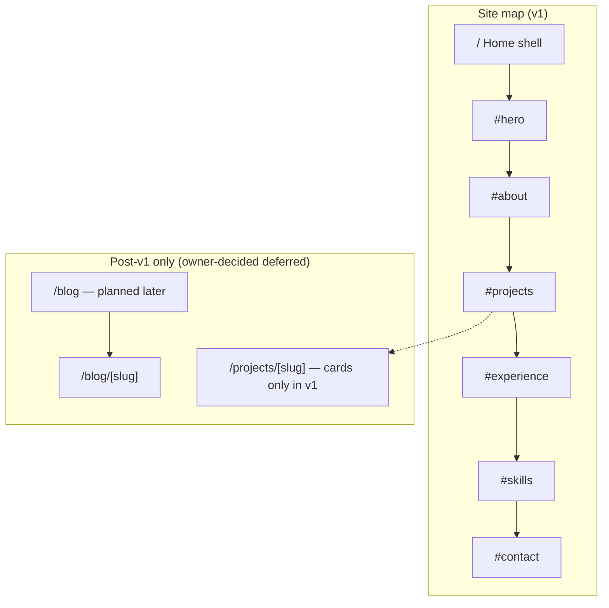
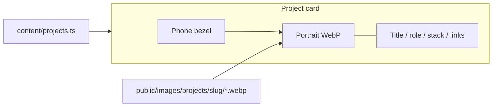
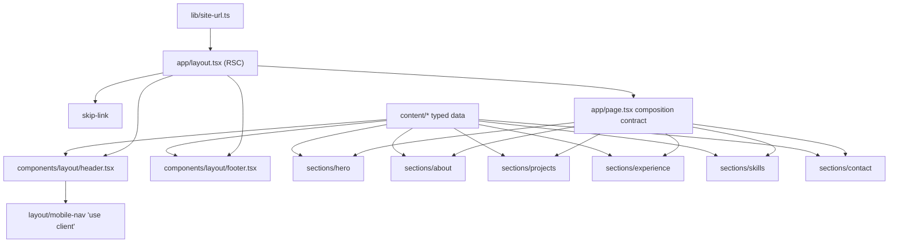
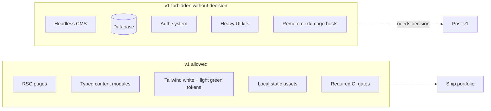
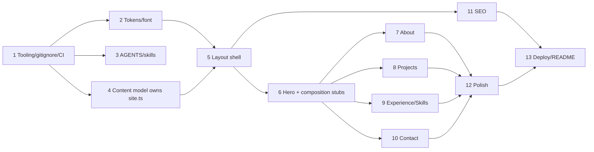

# Personal Portfolio Website — Full Planning Package

| Field | Value |
| --- | --- |
| **Title** | Personal Portfolio Website — Full Planning Package |
| **Author** | TBD (portfolio owner) |
| **Date** | 2026-07-27 |
| **Status** | Draft — owner aesthetic/blog/routes/contact decided; content/domain still open |
| **Workspace** | `/Users/gugan/Desktop/projects/portfolio` |
| **Package name** | `portfolio-app` (`package.json`) |
| **Package manager** | **npm** (lockfile `package-lock.json` present; do not switch managers without an explicit decision) |
| **Stack (verified)** | Next.js **16.2.12**, React **19.2.4**, Tailwind CSS **^4** (resolved **4.3.3**), TypeScript **^5**, ESLint **9** + `eslint-config-next` **16.2.12** |

**Effort band (feasibility):** ~13 small–medium PRs ≈ several focused solo sessions (roughly **1–2 weeks** calendar time with placeholder content). **Public launch is blocked** on owner-supplied content and domain (`SITE_URL`) — not on engineering throughput alone. Brand theme is **decided** (white + light green).

**Next implementation phase (owner priority):** After tooling if needed (PR 1), prioritize **PR 3 materials first — expand `AGENTS.md` + create full `.grok/skills/*`**. Full UI implementation follows; do not jump to visual sections before agent guardrails/skills unless tooling is broken.

---

## Overview

This document is a **complete planning package** for a personal developer/engineer portfolio built on the existing create-next-app scaffold. The repo today is boilerplate only: App Router entry points (`app/layout.tsx`, `app/page.tsx`, `app/globals.css`), Geist fonts, Tailwind v4 via `@import "tailwindcss"`, path alias `@/*`, and agent rules in `AGENTS.md` / `CLAUDE.md` pointing agents at version-matched docs under `node_modules/next/dist/docs/`. There is **no** portfolio content, no test/typecheck script, no `.grok/` skills directory, **dangerously incomplete `.gitignore` (currently only `node_modules`)**, and no deploy config beyond the default README Vercel note.

The proposed solution is a **static-first, content-in-repo** portfolio for a **Flutter-first mobile engineer** who also ships **backend** and **frontend web** work: typed TypeScript content modules, React Server Components by default, a single primary marketing surface (cards-only projects with **mobile screenshot / device-frame presentation**; no detail routes or blog in v1), Tailwind v4 **white + light green** design tokens, Vercel deploy, and a layered guardrail system (TypeScript, ESLint, AGENTS.md, project skills, **required** CI, PR checklists). Implementation is deferred until skills/AGENTS land per owner priority; this package defines product scope, architecture, AI skills, enforceable guardrails, and an ordered PR/slice plan so future agents can execute without inventing stack APIs or expanding scope.

### Owner positioning (product framing)

| Field | Guidance (placeholders until owner copy) |
| --- | --- |
| **Primary identity** | Flutter / mobile app developer |
| **Secondary strengths** | Backend APIs/services; frontend web apps |
| **Hero emphasis** | Mobile product craft first; full-stack range second |
| **Projects UI** | Prefer **phone device frames** + portrait screenshots for Flutter/mobile work; web projects may use landscape browser or desktop frames |
| **Skills IA** | Groups ordered roughly: Mobile (Flutter/Dart) → Backend → Web frontend → Tools/practices |

Agents must **not invent** employers, app names, store links, or metrics — use owner-supplied assets and copy only.

---

## Background & Motivation

### Current state (repo facts)

| Area | Current reality |
| --- | --- |
| Framework | Next.js App Router (`app/`), not Pages Router |
| UI | Default create-next-app home page (`app/page.tsx`) with Next/Vercel marketing copy |
| Layout | Root layout with `Metadata` title/description still `"Create Next App"` / generated boilerplate |
| Styling | Tailwind v4 PostCSS plugin; CSS variables `--background` / `--foreground`; `prefers-color-scheme` dark; `@theme inline` for Tailwind tokens |
| Font disconnect | `layout.tsx` wires Geist via `next/font` (`--font-geist-sans` / mono) and `@theme` maps `--font-sans`, but `body { font-family: Arial, Helvetica, sans-serif; }` in `globals.css` **overrides** intended Geist usage — scaffold bug to fix |
| Scripts | `dev`, `build`, `start`, `lint` only — **no** `typecheck`, `test`, or `format` |
| Lint | Flat config `eslint.config.mjs` with `eslint-config-next/core-web-vitals` + `typescript` |
| TypeScript | `strict: true` already; `@/*` → `./*` |
| Config | Empty `next.config.ts` options object |
| Assets | `public/*.svg` boilerplate; `app/favicon.ico` |
| **`.gitignore`** | **Broken / incomplete: single line `node_modules` only.** Missing `.next/`, `out/`, `.env*`, coverage, debug logs, OS junk, etc. Accidental commit of build output and secrets is currently possible. |
| Agent guidance | Minimal `AGENTS.md` (Next docs mandate only); `CLAUDE.md` re-exports it (`@AGENTS.md`) |
| Skills | No `.grok/skills/` yet |
| Package manager | npm with `package-lock.json` |

### Pain points this plan addresses

1. **Boilerplate ≠ product** — need IA, content model, and visual system before shipping.
2. **Next.js 16 breaking changes** — agents must not invent APIs from training data; docs live in-package (`node_modules/next/dist/docs/`, see bundled `ai-agents.md` guide).
3. **Scope creep risk** — personal portfolio can balloon into CMS/blog/auth/SaaS; guardrails and slices keep work incremental.
4. **Quality without heavy process** — solo developer needs automated gates (lint/typecheck/build **in CI**) and light a11y/perf checklists.
5. **Agent consistency** — project skills encode “how we work here” so Cursor/Grok-style agents implement one slice at a time against the same conventions.
6. **Unsafe defaults** — incomplete `.gitignore` must be fixed before any env or build artifacts exist.

### Why change now

Starting from a clean create-next-app tree is the right moment to lock **architecture, content ownership, and AI workflow** before the first feature PR. Retrofitting guardrails after ad-hoc components exist is more expensive than defining them up front.

---

## Goals & Non-Goals

### Goals

1. Ship a fast, accessible, SEO-friendly personal portfolio suitable for recruiting and professional networking.
2. Keep content in-repo as typed data so edits are PRs, not CMS admin work.
3. Prefer React Server Components; minimize client JS.
4. Encode quality via tooling + agent skills + definition of done, not tribal knowledge.
5. Deliver via small, **sequentially ordered** PR slices with clear file ownership (minimize merge thrash).
6. Deploy to **Vercel** (default Next.js path) with production metadata, sitemap, and robots.

### Non-Goals

1. **No application code in this phase** — design document only.
2. **No headless CMS, database, or auth** for v1.
3. **No blog in v1** — owner decided **later (planned post-v1)**; optional hooks only, no blog slice in v1.
4. **No heavy UI kit** (e.g. full Material/Chakra) unless a later decision justifies it.
5. **No multi-tenant / i18n platform** features (English-only v1).
6. **No inventing personal bio, project, or employment facts** — placeholders only.
7. **No premature animation libraries** until polish slice; motion is optional and progressive.
8. **No remote `next/image` hosts** in v1 (local `public/` only).
9. **No project detail routes in v1** — cards only (owner final).

---

## Proposed Design

### A. Portfolio product design

#### Recommended site sections

| Section | Purpose | Priority |
| --- | --- | --- |
| **Home / Hero** | Name, Flutter/mobile-forward headline, 1–2 sentence value prop (mobile + full-stack range), CTAs (View work / Contact; Resume when `resumeUrl` set); optional phone mockup or portrait | P0 |
| **About** | Narrative: mobile craft → backend/web range; location optional; resume when available | P0 |
| **Projects** | 3–8 featured apps/systems; **mobile screenshots in device frames** for Flutter work; problem, role, stack, outcomes, store/GitHub links | P0 |
| **Experience** | Reverse-chronological roles with mobile/backend/web highlights | P0 |
| **Skills** | Grouped: Mobile (Flutter/Dart), Backend, Web, Platforms/tools, Practices | P0 |
| **Contact** | Email, socials; v1 = `mailto:` + links (no form backend) | P0 |
| **Blog / writing** | **Planned post-v1** (owner: later). No v1 routes or MDX. | P2 (post-v1) |
| **Resume** | Optional link via `SiteConfig.resumeUrl` (PDF in `public/` or external). Not a separate page. **P2 for v1 launch** — hero/contact show the link **only when set**; omit CTA when absent. | P2 |

#### Information architecture: single-page vs multi-route

**Recommendation: hybrid single-page primary + optional detail routes.**

- **v1 primary UX**: one scrollable page (`/`) with in-page section anchors (`#hero`, `#about`, `#projects`, `#experience`, `#skills`, `#contact`). Sticky header nav targets sections.
- **v1 projects:** **Cards only** — no `/projects/[slug]` in v1 (owner decision). Detail routes remain optional post-v1 PR 14.
- **Blog:** **Not in v1** — planned later (post-v1 PR 15); site map may show blog as future-only.
- **Rationale**: fastest path to a complete portfolio; excellent LCP; trivial SEO for a personal brand site; less routing/layout complexity.



#### Anchor navigation & sticky header UX (normative for v1)

These are **core IA requirements**, not polish deferred to the end.

| Behavior | Spec |
| --- | --- |
| Section IDs | Each section root element sets a stable `id`: `hero`, `about`, `projects`, `experience`, `skills`, `contact`. |
| Sticky header | Header is `position: sticky; top: 0`. **Height must equal `--header-height`**: implement with `height` or `min-height: var(--header-height)` (and matching padding inside that box). Do not invent a second ad-hoc header height. If the real header must grow (e.g. multi-line mobile), **update `--header-height` in the same PR** so scroll-margin stays correct. |
| Scroll offset | **Single global rule** (preferred in `globals.css`, tokens or shell PR): `section[id] { scroll-margin-top: var(--header-height); }`. Do not scatter per-section magic numbers or mismatched `scroll-mt-*` utilities that disagree with the token. |
| Smooth scroll | Prefer **CSS** `html { scroll-behavior: smooth; }` on the document. Respect reduced motion: `@media (prefers-reduced-motion: reduce) { html { scroll-behavior: auto; } }`. Do not add a JS smooth-scroll library. |
| Skip link | First focusable control in `body`: “Skip to main content” → `#main` (or `#hero`). Required in **layout shell**, not only polish. |
| Focus management | Nav links are real `<a href="#…">`. On activation, browser default moves hash; ensure target is focusable if needed (`tabIndex={-1}` on section) so keyboard users land correctly after navigation. |
| Mobile nav | If hamburger/drawer is used: **close drawer after** a nav link is activated; restore focus sensibly (menu button or target). Escape closes drawer. |
| Active section | Optional later (IntersectionObserver); **not** required for v1. |

#### Content model (typed data)

Content lives in TypeScript modules under `content/`, validated by shared types in `lib/types/content.ts`. **No invented personal facts** — seed files use placeholders.

```ts
// Illustrative interfaces — normative conventions noted in comments

export type SocialLink = {
  label: string;       // e.g. "GitHub"
  href: string;        // https://...
  /**
   * When true (default if omitted): render with target=_blank and
   * rel="noopener noreferrer". Set false for same-origin paths.
   */
  external?: boolean;
};

/**
 * Site identity + contact content only.
 * Canonical site origin is NOT on this type — use getSiteUrl() from lib/site-url.ts
 * (env SITE_URL). Never put a url/origin field on SiteConfig or in content/site.ts.
 */
export type SiteConfig = {
  name: string;
  title: string;           // browser / OG title base
  description: string;     // meta description
  locale: string;          // e.g. "en_US"
  email: string;
  socials: SocialLink[];
  resumeUrl?: string;      // /resume.pdf or external; omit CTA when undefined
  ogImage?: string;        // path relative to site root, e.g. /og.png (not absolute)
};

/**
 * Visual treatment for project media.
 * - phone: portrait screenshot in a phone bezel (default for Flutter/mobile)
 * - phone-multi: 2–3 portrait shots in a small carousel or stacked devices
 * - browser: landscape web UI (for frontend web projects)
 * - plain: no device chrome (diagrams, logos, architecture)
 */
export type ProjectMediaKind = "phone" | "phone-multi" | "browser" | "plain";

export type ProjectPlatform =
  | "ios"
  | "android"
  | "mobile"      // both or Flutter general
  | "web"
  | "backend"
  | "fullstack";

export type ProjectImage = {
  src: string;           // e.g. /images/projects/foo/screen-1.webp
  alt: string;           // describe the screen, not "screenshot"
  width: number;         // intrinsic px
  height: number;
  /** Optional caption under device, e.g. "Home feed" */
  label?: string;
};

export type Project = {
  slug: string;
  title: string;
  summary: string;
  description?: string;
  role?: string;           // e.g. "Flutter developer", "Mobile + API"
  stack: string[];         // e.g. ["Flutter", "Dart", "Firebase", "Node.js"]
  highlights?: string[];
  links?: { label: string; href: string }[]; // App Store, Play, GitHub, Live demo
  /**
   * Primary visual. Prefer portrait phone screenshot for mobile apps.
   * width/height should match file; UI crops inside device frame.
   */
  image?: ProjectImage;
  /** Extra shots for phone-multi or gallery (max ~3 in v1 cards) */
  images?: ProjectImage[];
  mediaKind?: ProjectMediaKind; // default: "phone" if image looks portrait, else "plain"
  platforms?: ProjectPlatform[];
  featured?: boolean;
  year?: number;
  /** Ascending sort key among peers (lower first). Default: 0 */
  order?: number;
};

export type ExperienceItem = {
  company: string;
  title: string;
  location?: string;
  /**
   * ISO-ish start: prefer `YYYY-MM` for sortability; `YYYY` allowed
   * (treated as YYYY-01 for sort).
   */
  start: string;
  /**
   * End date same format as start, or omit / use isCurrent.
   * Convention: if isCurrent === true, end is ignored in UI ("Present").
   */
  end?: string;
  isCurrent?: boolean;
  summary?: string;
  highlights: string[];
  stack?: string[];
};

export type SkillGroup = {
  category: string;
  items: string[];
};

export type Profile = {
  headline: string;        // e.g. "Flutter developer building polished mobile products"
  subheadline?: string;    // e.g. "Also ships backend APIs and web frontends"
  about: string[];         // paragraphs
  location?: string;
  availability?: string;
  /**
   * Optional portrait for about/hero. Local path under public/.
   */
  avatar?: ProjectImage;
  /** Focus areas for chips or about list — owner-supplied only */
  focusAreas?: string[];   // e.g. ["Flutter", "Mobile UX", "APIs", "Web"]
};
```

**Skill group seed shape (illustrative categories — fill with real items):**

| Category (suggested order) | Example items (placeholders only) |
| --- | --- |
| Mobile | Flutter, Dart, iOS, Android, Riverpod/Bloc (as applicable) |
| Backend | Node / Nest / Django / Go / Firebase / REST / GraphQL (as applicable) |
| Web frontend | React, Next.js, TypeScript, HTML/CSS (as applicable) |
| Tools & platforms | Git, CI/CD, Figma, Play Console, App Store Connect |
| Practices | Testing, architecture, accessibility, performance |

#### Mobile-first project presentation (v1 cards)

Projects section is **optimized for Flutter/mobile screenshots**, not generic landscape marketing images.

| Concern | Spec |
| --- | --- |
| Default frame | **Phone device chrome** (CSS or lightweight SVG bezel) around portrait `next/image` |
| Aspect ratio | Target source ~**9:19.5** or **9:16** (modern phone). Store true `width`/`height` on the image object |
| Card layout | Desktop: image left/right + copy; or image-top with phone centered on soft green/white panel. Mobile viewport: stacked phone above text |
| Multi-screen | `mediaKind: "phone-multi"` shows up to **3** frames (or one primary + “+N screens” without heavy carousel JS — prefer static stack/fan for v1 CLS) |
| Web projects | `mediaKind: "browser"` optional simple browser chrome; landscape ok |
| Backend-only | `mediaKind: "plain"` — architecture diagram or logo mark; no fake phone UI |
| Fallback | If no image: soft accent panel + title monogram / stack badges (no broken image) |
| CLS | Always reserve device frame box with aspect-ratio CSS; never load remote screenshots in v1 |
| a11y | Meaningful `alt` per screen (“Login screen with email form”, not “image1”) |



**Selector algorithms** (`lib/content/index.ts`) — normative:

| Selector | Algorithm |
| --- | --- |
| `getFeaturedProjects()` | Filter `featured === true`; if none flagged, use all. Sort by `order` ascending (missing → `0`), then `year` descending, then `title` localeCompare. |
| `getProjects()` | All projects, same sort as above. |
| `getExperience()` | Sort key (stable, multi-role safe): (1) `isCurrent === true` before false/undefined; (2) then `start` descending after normalizing `YYYY` → `YYYY-01`; (3) then `company` localeCompare. UI shows “Present” when `isCurrent`, else `end` or open-ended. |
| `getSiteConfig()` | Returns the static `content/site.ts` export **as-is** (name, title, description, locale, email, socials, resumeUrl, ogImage). **No origin/url field.** Absolute URLs always via `getSiteUrl()`. |
| `getSiteUrl()` | **Sole** canonical origin: `process.env.SITE_URL` (trim, no trailing slash); if missing → `http://localhost:3000` + documented warning. Used by metadata, sitemap, robots, any absolute link construction. |

**Content files (proposed):**

| Path | Role | Owning PR |
| --- | --- | --- |
| `content/site.ts` | `SiteConfig` (**no `url` field**) | **Content model PR only** (layout consumes; does not create) |
| `content/profile.ts` | Hero + about copy | Content model (seed); Hero/About PRs may fill placeholders |
| `content/projects.ts` | `Project[]` | Content model |
| `content/experience.ts` | `ExperienceItem[]` | Content model |
| `content/skills.ts` | `SkillGroup[]` | Content model |
| `lib/types/content.ts` | Types | Content model |
| `lib/content/index.ts` | Re-exports + selectors | Content model |
| `lib/site-url.ts` | `getSiteUrl()` only | Content model PR; **only** origin source |

#### UX notes

- **Navigation**: sticky header; section links; mobile drawer or compact row; focus-visible styles; skip link (see anchor UX table).
- **Dark mode (v1 Key Decision):** **system preference only** via `prefers-color-scheme` (matches current CSS pattern). Manual toggle is post-v1 (optional PR).
- **Language (v1):** English-only (`lang="en"` on `<html>`).
- **Accessibility baseline**: semantic landmarks (`header`, `main`, `nav`, `footer`, `section` with headings), skip link, contrast AA, keyboard nav, meaningful `alt`, form labels if contact form exists later.
- **Motion**: prefer CSS; respect `prefers-reduced-motion`.

#### SEO & metadata strategy

Use Next.js Metadata APIs from **Server Components only** (per bundled docs `14-metadata-and-og-images.md`):

| Mechanism | Usage |
| --- | --- |
| Root `metadata` / `generateMetadata` in `app/layout.tsx` | `title` template, `description`, `metadataBase`, `openGraph`, `twitter`, `robots` |
| `app/sitemap.ts` | Static sitemap from **same URL source** as `metadataBase` |
| `app/robots.ts` | Allow crawl; point to sitemap |
| `app/opengraph-image.tsx` or static OG asset | Share cards |
| JSON-LD (`Person` / `WebSite`) | Optional in layout or home |
| Canonical URL | From site URL policy below |

##### Metadata ownership split: PR 5 vs PR 11 (normative)

| Concern | Owning PR | Allowed in that PR |
| --- | --- | --- |
| `title`, `description` from `getSiteConfig()` | **PR 5 (layout shell)** | Required — replace create-next-app strings |
| `metadataBase: new URL(getSiteUrl())` | **PR 5** | Required minimal absolute-URL base (helper already exists from PR 4) |
| `openGraph` / `twitter` rich fields, images | **PR 11** | Full social cards |
| `app/sitemap.ts`, `app/robots.ts` | **PR 11** | File conventions |
| `opengraph-image` route/static asset, JSON-LD | **PR 11** | Share + structured data |
| Title template polish (`%s \| Name`) | **PR 11** (or extend PR 5 only if already present) | Prefer PR 11 if expanding |

**PR 5 must not** invent OG image routes, sitemap, robots, or JSON-LD. **PR 11** extends `app/layout.tsx` metadata only for SEO fields listed above — avoid re-litigating title/description/`metadataBase` unless fixing a bug.

##### `metadataBase` / `SITE_URL` policy (normative)

Incorrect `metadataBase` produces wrong absolute OG URLs and sitemap entries. Policy:

1. **Single source of origin — `getSiteUrl()` only.** Environment variable **`SITE_URL`** (server-side) documented in `.env.example`. **Do not** store origin on `SiteConfig` or in `content/site.ts`. Prefer server-only construction for metadata/sitemap; do not require `NEXT_PUBLIC_SITE_URL` unless a true client need appears later.
2. **`.env.example`:**
   ```bash
   # Canonical origin, no trailing slash. REQUIRED before public launch.
   # Local dev example:
   SITE_URL=http://localhost:3000
   # Production example (replace with real domain):
   # SITE_URL=https://your-domain.com
   ```
3. **Interim / preview:** Vercel Preview deployments may use deployment URL via env; document in README that production domain must be set in the Vercel project env for Production. Do **not** commit `https://example.com` as if it were real.
4. **Build-time guidance:** Only `getSiteUrl()` reads `process.env.SITE_URL`. If missing during `next build` in CI without env, fall back to `http://localhost:3000` **and** README/warning — never invent a personal domain. **Launch checklist:** production `SITE_URL` must be the real domain (Open Question 3 is a **blocker for public cutover**).
5. **Sitemap/OG/metadata:** All absolute URLs derive from `getSiteUrl()` only — no duplicated string literals, no `site.url`, no parallel helpers.

#### Performance targets (Core Web Vitals)

| Metric | Target (p75 mobile) | Strategy |
| --- | --- | --- |
| **LCP** | ≤ 2.5s | RSC HTML, optimized fonts (`next/font`), priority hero image if any, minimal client JS |
| **INP** | ≤ 200ms | Few client components; no heavy listeners |
| **CLS** | ≤ 0.1 | Explicit image dimensions; reserved header height; font display via next/font |
| **Bundle** | Prefer near-static page | No CMS client SDK; no large UI kits; no remote image config needed |

#### Brand / visual system (owner final: white + light green)

**Key Decision (FINAL):** v1 visual system is **white + light green** — light-first surfaces with a **light green accent** for links, CTAs, and focus rings. This replaces the earlier interim monochrome-only guidance.

| Role | Guidance |
| --- | --- |
| Background | White / near-white (`--background`) |
| Foreground | Near-black text for readability |
| Accent | **Light green** semantic token(s) e.g. `--accent` / `--accent-foreground` — use for primary buttons, text links, focus outline |
| Muted / border | Soft neutrals (zinc/gray) that pair with white + green |
| Dark mode | Still supported via **`prefers-color-scheme`** (system only): dark surfaces with a **softened light-green accent** that meets contrast — primary brand story remains light green on white |
| Typography | **Geist Sans / Geist Mono** (fix Arial body override) |
| Spacing | Tailwind default scale; shared `Container` max-width (pick one in layout shell and reuse) |

**Agent rule:** Use only the defined white/neutral + light-green token set from the tokens PR. **Do not invent** random brand palettes (purple neon, multi-hue systems, etc.). Exact green hex may be chosen once in the tokens PR within a “light green” band (e.g. soft mint/sage/emerald-light) and then reused everywhere.

---

### B. Technical architecture (code-level)

#### Directory structure (proposed)

Keep **no `src/`** folder (matches current repo layout).

```text
portfolio/
├── AGENTS.md
├── CLAUDE.md
├── package.json
├── package-lock.json          # npm lock — source of truth
├── tsconfig.json
├── eslint.config.mjs
├── next.config.ts             # no remote images in v1
├── postcss.config.mjs
├── .gitignore                 # FIXED in PR 1 — full Next ignore set
├── .env.example               # SITE_URL documented; no secrets
├── .github/workflows/ci.yml   # REQUIRED (lint + typecheck + build)
├── .grok/
│   └── skills/
│       ├── portfolio-slice/SKILL.md
│       ├── portfolio-content/SKILL.md
│       ├── portfolio-a11y-pass/SKILL.md
│       ├── portfolio-review/SKILL.md
│       └── portfolio-visual-polish/SKILL.md   # OPTIONAL skill; create only if used
├── app/
│   ├── layout.tsx
│   ├── page.tsx               # home composition contract (see below)
│   ├── globals.css
│   ├── favicon.ico
│   ├── robots.ts
│   ├── sitemap.ts
│   ├── opengraph-image.tsx    # or static file
│   ├── not-found.tsx          # owned by layout shell PR
│   └── projects/              # optional v1.1
│       └── [slug]/page.tsx
├── components/
│   ├── layout/
│   │   ├── header.tsx
│   │   ├── footer.tsx
│   │   ├── mobile-nav.tsx     # client if interactive
│   │   └── skip-link.tsx
│   ├── sections/
│   │   ├── hero.tsx
│   │   ├── about.tsx          # may start as stub
│   │   ├── projects.tsx
│   │   ├── experience.tsx
│   │   ├── skills.tsx
│   │   └── contact.tsx
│   ├── ui/
│   │   ├── button.tsx
│   │   ├── container.tsx
│   │   ├── section-heading.tsx
│   │   └── external-link.tsx
│   └── projects/
│       ├── project-card.tsx
│       ├── project-list.tsx
│       └── device-frame.tsx   # phone (default) / browser chrome
├── content/
│   ├── site.ts
│   ├── profile.ts
│   ├── projects.ts
│   ├── experience.ts
│   └── skills.ts
├── lib/
│   ├── types/
│   │   └── content.ts
│   ├── content/
│   │   └── index.ts
│   ├── site-url.ts            # getSiteUrl() from env
│   └── utils/
│       └── cn.ts              # DO NOT add until third call site needs it
├── public/
│   ├── images/                # local only in v1
│   │   ├── avatar.webp        # optional portrait
│   │   └── projects/<slug>/   # cover.webp + optional screens (phone portrait)
│   ├── resume.pdf             # optional
│   └── og.png                 # optional until SEO PR
└── README.md
```

#### Home composition contract (`app/page.tsx`)

**Problem:** Multiple section PRs must not thrash `app/page.tsx`.

**Contract (normative):**

1. The **Hero / home composition PR** is the **sole owner** of structural changes to `app/page.tsx` for v1 section order.
2. In that PR, `app/page.tsx` imports **all** section components in final order and renders them inside `<main id="main">`.
3. Sections not yet implemented ship as **lightweight stubs** in the same PR (or as stub files under `components/sections/*` that render a single heading + `aria-hidden` placeholder comment). Example:

```tsx
// app/page.tsx — composition owned by Hero PR; later PRs avoid editing this file
import { Hero } from "@/components/sections/hero";
import { About } from "@/components/sections/about";
import { Projects } from "@/components/sections/projects";
import { Experience } from "@/components/sections/experience";
import { Skills } from "@/components/sections/skills";
import { Contact } from "@/components/sections/contact";

export default function HomePage() {
  return (
    <main id="main">
      <Hero />
      <About />
      <Projects />
      <Experience />
      <Skills />
      <Contact />
    </main>
  );
}
```

4. **Later section PRs (About, Projects, Experience/Skills, Contact) only replace stub implementations inside their section files** — they do **not** modify `app/page.tsx` unless a bugfix is required (document in PR).
5. “Independently mergeable” means: after the composition PR lands, section PRs are independent **of each other** (different files), not parallelizable with the composition PR itself.



**Composition pattern:**

- Pages/layouts are **Server Components** that import content and pass props into section components (or sections import content directly — pick one style in content PR and stick to it; **recommendation:** sections import from `@/lib/content` to keep `page.tsx` free of data logic).
- Section components default to **server**; only leaves that need state/events get `'use client'`.
- UI primitives stay presentation-only.

#### Content strategy decision: typed TS data (recommended)

| Option | Pros | Cons | Verdict |
| --- | --- | --- | --- |
| **Typed TS modules in `content/`** | Type-safe, PR-reviewed, zero runtime deps, works with RSC, easy agent edits | Owner must edit code/PR for content | **Choose for v1** |
| MDX | Rich prose, great for blog/case studies | Extra toolchain, harder schema validation | Defer for blog/long case studies |
| Headless CMS | Non-dev editing | Cost, auth, preview complexity | Out of scope for solo v1 |

#### Styling system (Tailwind v4)

Build on existing patterns in `app/globals.css`:

```css
@import "tailwindcss";

:root {
  --header-height: 4rem; /* header component MUST use this; scroll-margin reads it */
  --background: #ffffff;
  --foreground: #171717;
  --muted: #737373;
  --border: #e5e5e5;
  /* Owner brand: white + light green — pick one light-green pair in tokens PR and reuse */
  --accent: #86efac;           /* example light green — adjust once, then freeze */
  --accent-foreground: #14532d; /* dark green text on accent buttons if needed */
  --ring: var(--accent);       /* focus rings */
}

/* Global scroll offset for sticky header — keep --header-height in sync with header */
section[id] {
  scroll-margin-top: var(--header-height);
}

@theme inline {
  --color-background: var(--background);
  --color-foreground: var(--foreground);
  --color-muted: var(--muted);
  --color-border: var(--border);
  --color-accent: var(--accent);
  --color-accent-foreground: var(--accent-foreground);
  --color-ring: var(--ring);
  --font-sans: var(--font-geist-sans);
  --font-mono: var(--font-geist-mono);
}

@media (prefers-color-scheme: dark) {
  :root {
    --background: #0a0a0a;
    --foreground: #ededed;
    --muted: #a3a3a3;
    --border: #262626;
    --accent: #4ade80;           /* slightly stronger light green on dark */
    --accent-foreground: #052e16;
    --ring: var(--accent);
  }
}

html {
  scroll-behavior: smooth;
}

@media (prefers-reduced-motion: reduce) {
  html {
    scroll-behavior: auto;
  }
}

body {
  background: var(--background);
  color: var(--foreground);
  /* Fix scaffold bug: use Tailwind font-sans / next/font variable, NOT Arial */
}
```

**Font fix (required in tokens or layout PR):** `body` must use `className` including `font-sans` from layout, or CSS `font-family: var(--font-geist-sans), ui-sans-serif, system-ui, sans-serif`. Remove hard-coded `Arial, Helvetica, sans-serif` override.

**`cn` utility:** Do **not** add `clsx` / `tailwind-merge` or `lib/utils/cn.ts` until at least **three** call sites need conditional class merging. Prefer template strings or single-purpose class lists. If added later, prefer a 5-line local filter helper before new dependencies.

#### Image / asset strategy (mobile-first)

| Asset type | Approach |
| --- | --- |
| **Mobile app screenshots** | **Primary project media.** Portrait captures; local `public/images/projects/<slug>/`; shown in **phone device frames** |
| Web UI shots | Landscape optional; browser chrome or plain; same folder convention |
| Backend / diagrams | PNG/SVG architecture or logo; `mediaKind: "plain"` |
| Logos / icons | SVG in `public/` or simple inline SVG |
| Avatar / portrait | Local optimized WebP/AVIF via `next/image` (`profile.avatar`) |
| Hero optional | Same avatar **or** one hero phone composite (owner-supplied) |
| Resume | Optional `public/resume.pdf` or external URL in `SiteConfig.resumeUrl` |
| Favicon / app icons | `app/favicon.ico` + optional `public/icon-*.png` |
| OG image | Static `/og.png` or generated `opengraph-image` — prefer branded white+green, not a random screenshot |
| **Remote images** | **Forbidden in v1.** No Play/App Store CDN URLs in `next/image`. Export and commit local files. |

**Directory convention:**

```text
public/
├── images/
│   ├── avatar.webp                 # optional portrait
│   ├── hero/                       # optional hero art
│   └── projects/
│       ├── <slug>/
│       │   ├── cover.webp          # primary (phone portrait preferred)
│       │   ├── screen-2.webp       # optional
│       │   └── screen-3.webp
│       └── ...
├── resume.pdf                      # optional
└── og.png                          # optional until SEO PR
```

**Optimization budget (Projects PR DoD):**

| Rule | Spec |
| --- | --- |
| Format | Prefer **WebP** (or AVIF); PNG only if transparency required |
| Phone source size | Long edge **≤ 1600px** (e.g. ~800×1730 or 900×1950); larger sources must be compressed before commit |
| Web landscape | Long edge **≤ 1600px**; display max ~1200px wide |
| File size | Target **≤ 250KB** per screenshot; hero **≤ 400KB** |
| Metadata | Always set `width`, `height`, descriptive `alt` in content |
| Device chrome | Implemented in UI (CSS/SVG) — **do not** require screenshots already framed in a physical phone photo (clean UI captures preferred) |
| Status bar | Prefer screenshots **without** personal notifications; full-bleed app UI |

**Owner asset checklist:** see **`docs/asset-checklist.md`** (what to export, naming, and minimum set).

#### API routes / server actions

| Need | Recommendation |
| --- | --- |
| Contact form v1 | **`mailto:` + social links** (zero backend) |
| Contact form v1.1 | Server Action or Route Handler + provider; rate limit; server-only secrets |
| Analytics | Optional post-deploy; no custom API |
| CMS API | Do not add |

Email may appear as plain text / `mailto:` in HTML (acceptable for portfolios; harvester risk low). No obfuscation required for v1. **“Spam-safe” language applies only if a form backend is added later.**

#### Testing strategy (proportional)

| Layer | Tooling | Scope |
| --- | --- | --- |
| Typecheck | `tsc --noEmit` via `npm run typecheck` | Every PR |
| Lint | `npm run lint` | Every PR |
| Unit | Optional Vitest | Pure helpers only if any |
| E2E | Playwright later | Optional post-v1 smoke |

**v1 minimum:** `lint` + `typecheck` + `build` must pass locally and in **CI**.

#### CI / quality gates (required)

Proposed `package.json` scripts:

```json
{
  "scripts": {
    "dev": "next dev",
    "build": "next build",
    "start": "next start",
    "lint": "eslint",
    "typecheck": "tsc --noEmit"
  }
}
```

**CI is required, not optional.** Assumption: remote is **GitHub** → add `.github/workflows/ci.yml` in foundations tooling PR:

- on pull_request + push to default branch
- Node LTS, `npm ci`
- `npm run lint`
- `npm run typecheck`
- `npm run build` (set `SITE_URL=http://localhost:3000` in CI env for metadata)

If the project is **not** hosted on GitHub, document in README that **Vercel deployment checks** (build failure blocks merge/deploy) are the remote gate — still required, not optional. Do not leave “optional CI” ambiguity.

---

### C. Guardrails

#### 1. Code-level guardrails

| Guardrail | Encoding | Rule |
| --- | --- | --- |
| TypeScript strictness | `tsconfig.json` | Keep `strict`; do not weaken |
| ESLint + Core Web Vitals | `eslint.config.mjs` | Keep next core-web-vitals + typescript |
| File/component size | AGENTS.md + review skill | Soft ~200–300 LOC; split when large |
| Accessibility | AGENTS.md + a11y skill + DoD | Semantic HTML; keyboard; focus; alt; skip link; scroll-margin |
| Secrets + gitignore | `.gitignore`, AGENTS.md, `.env.example` | Full Next ignore set; never commit `.env.local` / `.next` |
| Dependency discipline | AGENTS.md + slice DoD | Justify new deps; no UI kits; no `cn` stack by default |
| Path alias | `tsconfig` `@/*` | Consistent imports |
| Package manager | lockfile | npm only unless decided otherwise |
| Images | `next.config.ts` | Local `public/` only in v1 |

#### 2. Architecture guardrails

| Rule | Detail |
| --- | --- |
| Content ≠ presentation | UI imports from `content/` / `lib/content` |
| Single owner for `content/site.ts` | Content-model PR creates; layout only imports |
| Home composition contract | Only Hero PR structures `page.tsx`; sections fill stubs |
| RSC default | Client only for interactivity |
| No premature backend | No DB, auth, CMS in v1 |
| Docs before APIs | Read `node_modules/next/dist/docs/` first |
| Static-first | Avoid force-dynamic |
| Single design system | Tokens in `globals.css`; **white + light green** (owner final) |



#### 3. Process guardrails

**Definition of Done (every slice/PR) — canonical checklist (copy into skills):**

1. Implements only the slice goal (no drive-by refactors outside scope).
2. `npm run lint` passes.
3. `npm run typecheck` passes.
4. `npm run build` passes.
5. No secrets committed; `.gitignore` still excludes `.env*`, `.next/`, etc.
6. UI smoke: page loads; no obvious break at ~320px and desktop.
7. A11y smoke (UI slices): keyboard for new controls; heading hierarchy; image alt; skip link still works if shell present.
8. Content slices: types compile; placeholders clearly marked; no fabricated biography.
9. PR description: scope, out-of-scope, new dependency justification (if any).
10. File ownership respected (`page.tsx` / `content/site.ts` rules).

**Visual / a11y smoke checklist (UI slices):**

- [ ] Skip link present (after shell PR)
- [ ] Section ids + `scroll-margin-top` for sticky header
- [ ] Contrast roughly AA
- [ ] Focus rings visible
- [ ] Mobile nav keyboard + closes on navigate
- [ ] No horizontal scroll at 320px
- [ ] `prefers-reduced-motion` respected

#### 4. Agent / AI guardrails

| Rule | Why |
| --- | --- |
| Always read `node_modules/next/dist/docs/` before App Router APIs | Next 16 ≠ training data |
| Never invent Next.js APIs from memory | Breaking changes |
| Do not expand beyond current slice | Reviewable PRs |
| Do not add dependencies without justification | Bundle + maintenance |
| Do not invent personal bio/project facts | Placeholders only |
| Do not invent brand colors beyond white + light green tokens | Owner aesthetic decided |
| Do not add remote image patterns casually | v1 local-only |
| Prefer editing existing patterns | Clarity |
| Run quality gates before claiming done | lint/typecheck/build |
| Load project skills from `.grok/skills/<name>/SKILL.md` when invoked | Consistent workflow |

#### How guardrails are encoded

| Mechanism | What it enforces |
| --- | --- |
| `.gitignore` | Build artifacts + env secrets never committed |
| `AGENTS.md` | Next docs, portfolio conventions, ownership rules, white + light green brand |
| `CLAUDE.md` | `@AGENTS.md` |
| `.grok/skills/*` | Full SKILL.md workflows with DoD checkboxes |
| `tsconfig.json` | Strict typing |
| `eslint.config.mjs` | Next + CWV |
| `.github/workflows/ci.yml` | **Required** remote gates |
| PR descriptions | Human + agent review |

---

### D. AI skills to create (`.grok/skills/`)

Skills are **required for this agentic planning/execution process** (this package assumes Grok/Cursor-style agents). A solo human can ignore skills and follow AGENTS.md + PR plan only; skills are not a runtime dependency of the site.

**Discovery / loading convention:** project skills live at `.grok/skills/<skill-name>/SKILL.md`. Agents should open the relevant SKILL.md when the user invokes the skill by name or when the task matches `when_to_use`.

#### Canonical SKILL.md skeleton (every skill uses this structure)

```markdown
---
name: portfolio-<name>
description: <one line>
---

# <Title>

## When to use
...

## Inputs
...

## Non-goals
...

## Steps
1. ...
2. ...

## Commands (exact)
- `npm run lint`
- `npm run typecheck`
- `npm run build`

## Definition of Done
- [ ] ... (include canonical DoD items from Guardrails §3)

## Failure behavior
- If lint/typecheck/build fail: fix before finishing; do not claim done.
- If Next API uncertainty: read node_modules/next/dist/docs/... and cite path.
- If owner content missing: use placeholders; never invent facts.

## Example invocation
> Use portfolio-slice to implement PR N: <title>
```

**PR that lands skills** delivers **complete SKILL.md files** (not empty stubs): full steps, DoD checkboxes, commands, non-goals. “Stub” is disallowed wording — ship usable skills in the skills PR.

#### Skill inventory

| Skill name | Purpose / when to invoke |
| --- | --- |
| `portfolio-slice` | Implement one development slice / PR end-to-end with DoD |
| `portfolio-content` | Add/edit typed content without breaking schema |
| `portfolio-a11y-pass` | Accessibility audit + fix pass for a page/section |
| `portfolio-review` | Code review against repo conventions |
| `portfolio-visual-polish` | Optional: spacing, typography, motion, token consistency — **create file only when first needed** |

---

#### 1. `portfolio-slice`

**Path:** `.grok/skills/portfolio-slice/SKILL.md`

**When to use:** Implementing any numbered PR/slice from this design.

**Inputs:** PR number/title, acceptance criteria, out-of-scope list.

**Outputs:** Code limited to slice ownership; PR description draft; green lint/typecheck/build.

**Steps (high level):**

1. Read `AGENTS.md` + this skill + slice acceptance criteria.
2. If touching Next APIs, open the relevant `node_modules/next/dist/docs/` guide first.
3. Respect file ownership (`content/site.ts`, `app/page.tsx` composition contract).
4. Implement minimal change set.
5. Avoid new dependencies; justify if unavoidable.
6. Run `npm run lint && npm run typecheck && npm run build`.
7. Complete DoD checkboxes.
8. Stop — do not start the next slice.

---

#### 2. `portfolio-content`

**Path:** `.grok/skills/portfolio-content/SKILL.md`

**When to use:** Adding/editing projects, experience, skills, profile, or site config values.

**Inputs:** Owner-supplied content; target modules.

**Outputs:** Updated `content/*` only (unless types must extend — then same PR).

**Steps:** Read types → map owner input → no invention → keep slugs stable → run typecheck → do not restyle UI.

**Selector note:** Follow featured/order sort rules in Content model section.

---

#### 3. `portfolio-a11y-pass`

**Path:** `.grok/skills/portfolio-a11y-pass/SKILL.md`

**When to use:** After UI sections land, or when fixing a11y bugs.

**Inputs:** Target section/route.

**Outputs:** Fixes + short residual-risk notes.

**Steps:** landmarks/headings → keyboard/focus → alt → contrast tokens → reduced motion → prefer semantic HTML → run gates.

---

#### 4. `portfolio-review`

**Path:** `.grok/skills/portfolio-review/SKILL.md`

**When to use:** Reviewing a PR/diff before merge.

**Outputs:** Findings (block/major/nit); pass/fail DoD.

**Checklist:** scope; RSC vs client; content imports; white + light green tokens only; Next docs; deps; secrets/gitignore; a11y; ownership of `page.tsx` / `site.ts`; no remote images; no blog/detail routes in v1.

---

#### 5. `portfolio-visual-polish` (optional file)

**When to use:** Final visual pass for white + light green consistency, spacing, and contrast.

**Non-goals:** New features; inventing non-green accent palettes; adding animation libraries by default; blog or project detail pages.

---

#### `AGENTS.md` updates (required content)

1. Keep **“This is NOT the Next.js you know”** + docs path mandate.
2. Portfolio: static-first; `content/`; no CMS/auth/db in v1.
3. RSC policy; slice discipline; dependency discipline.
4. Content honesty; white + light green brand tokens only.
5. File ownership: `content/site.ts` (content PR); `app/page.tsx` composition contract.
6. Quality gates: `npm run lint|typecheck|build` + CI.
7. Skills path: `.grok/skills/`.
8. `.gitignore` must remain complete; never weaken env/build ignores.
9. Images local-only; npm as package manager.
10. Anchor UX: scroll-margin, skip link, reduced motion.

---

### E. Development slices (detailed)

Relative sizes: **S** / **M** / **L**. Ownership rules supersede “touch whatever.”

**Ordering principle:** Tooling → tokens/docs → **content model (owns `site.ts`)** → **layout shell (consumes content)** → **home composition + stubs** → section fill-ins → SEO → polish → deploy docs.

---

#### Slice 1 — Tooling foundations (`.gitignore`, scripts, CI)

| Field | Detail |
| --- | --- |
| **Title** | Tooling foundations: gitignore, typecheck, CI, env example |
| **Goal** | Make the repo safe and gateable before any feature work |
| **Files** | `.gitignore` (**full Next/create-next-app set**), `package.json` (`typecheck` script), `.github/workflows/ci.yml` (**required**), `.env.example` (`SITE_URL`) |
| **Dependencies** | None |
| **Acceptance / DoD** | `.gitignore` includes at least: `node_modules/`, `.next/`, `out/`, `build/`, `.env*`, `!.env.example`, logs, `coverage/`, `.vercel/`, TS build info, OS files as appropriate; `npm run typecheck` works; CI runs lint + typecheck + build on PR; no portfolio UI required |
| **Out of scope** | Tokens, skills prose, sections, content model |
| **Size** | S |

**Minimum `.gitignore` themes to restore (illustrative list for implementers):**

```gitignore
# dependencies
node_modules/

# next.js
.next/
out/

# env (keep example)
.env*
!.env.example

# debug / os / vercel / typescript
npm-debug.log*
.DS_Store
*.tsbuildinfo
next-env.d.ts
.vercel
coverage/
```

(Note: if `next-env.d.ts` is currently tracked by the scaffold, follow Next 16 docs guidance — do not blindly delete required types; prefer ignoring generated artifacts consistently with official template.)

---

#### Slice 2 — Design tokens + folder skeleton + font fix

| Field | Detail |
| --- | --- |
| **Title** | Monochrome design tokens, font fix, empty structure |
| **Goal** | Interim visual system + directories for later PRs |
| **Files** | `app/globals.css` (tokens, scroll-behavior, **remove Arial body override**), `app/layout.tsx` only if needed for `font-sans` on body, placeholder dirs via `.gitkeep` or deferred until first real file |
| **Dependencies** | Slice 1 |
| **Acceptance / DoD** | Semantic **white + light green** tokens (`--background`, `--foreground`, `--accent`, `--ring`, etc.); define `--header-height` (default `4rem`); global `section[id] { scroll-margin-top: var(--header-height); }` preferred here or deferred to shell with same token; smooth scroll + reduced-motion; Geist actually applies to body; accent used only via tokens (no random hex in components) |
| **Out of scope** | Header/footer UI (token only — shell must couple to it), content modules, skills markdown |
| **Size** | S |

---

#### Slice 3 — AGENTS.md + project skills

| Field | Detail |
| --- | --- |
| **Title** | Agent guardrails and full project skills |
| **Goal** | Expand AGENTS.md; ship complete SKILL.md files for the four required skills |
| **Files** | `AGENTS.md`, `.grok/skills/portfolio-slice/SKILL.md`, `portfolio-content`, `portfolio-a11y-pass`, `portfolio-review` (optional polish skill deferred) |
| **Dependencies** | Slice 1 (can follow Slice 2) |
| **Acceptance / DoD** | Each skill has full skeleton (when_to_use, steps, commands, DoD checkboxes, failure behavior, example invocation); AGENTS documents ownership + **white + light green** brand + docs-first + no blog/detail routes in v1 |
| **Out of scope** | Application UI sections |
| **Size** | M |
| **Owner priority** | **Do this soon** — preferred next implementation work after tooling (PR 1) if gitignore/CI not yet done; skills/AGENTS before full UI |

---

#### Slice 4 — Content model + seed data (**owns `content/site.ts`**)

| Field | Detail |
| --- | --- |
| **Title** | Typed content model and placeholder seed data |
| **Goal** | Single introduction of types + all content modules including `site.ts` |
| **Files** | `lib/types/content.ts`, `content/site.ts`, `content/profile.ts`, `content/projects.ts`, `content/experience.ts`, `content/skills.ts`, `lib/content/index.ts`, `lib/site-url.ts` |
| **Dependencies** | Slice 1 (types independent of tokens; prefer after 1) |
| **Acceptance / DoD** | Types compile; `SiteConfig` has **no `url` field**; seed `content/site.ts` has no origin; selectors implement featured/order/`getExperience` tie-break rules; `getSiteUrl()` is sole origin reader of `SITE_URL`; **no other PR creates `content/site.ts`** |
| **Out of scope** | Section UI; OG/sitemap (PR 11) |
| **Size** | M |

---

#### Slice 5 — Layout shell (**consumes** content; does not create `site.ts`)

| Field | Detail |
| --- | --- |
| **Title** | Layout shell: skip link, header, footer, not-found, metadata baseline |
| **Goal** | Portfolio chrome with correct anchor UX primitives |
| **Files** | `app/layout.tsx`, `app/not-found.tsx`, `components/layout/header.tsx`, `footer.tsx`, `skip-link.tsx`, `mobile-nav.tsx` (if needed), `components/ui/container.tsx`, `components/ui/external-link.tsx`, ensure global `section[id]` scroll-margin if not already in Slice 2 |
| **Dependencies** | **Slice 4 (content model)** + Slice 2 (tokens) |
| **Acceptance / DoD** | Sticky header **height coupled to `--header-height`** (header uses token; if measured height differs, update token in this PR); global `section[id] { scroll-margin-top: var(--header-height); }` present; nav links to `#about` etc.; skip link works; footer socials from `getSiteConfig()`; **metadata only:** `title`, `description` from content + `metadataBase: new URL(getSiteUrl())` — **no** OG image routes, sitemap, robots, or JSON-LD; `not-found.tsx` branded minimally; mobile nav closes on navigate if present; focus-visible styles |
| **Out of scope** | Full section bodies; content schema changes; rich SEO (openGraph/twitter/sitemap/robots/JSON-LD → Slice 11) |
| **Size** | M |

---

#### Slice 6 — Hero + home composition contract + section stubs

| Field | Detail |
| --- | --- |
| **Title** | Hero section and home composition with stubs |
| **Goal** | Own `app/page.tsx` structure forever (v1); real Hero; stub other sections |
| **Files** | `app/page.tsx`, `components/sections/hero.tsx`, stub files for about/projects/experience/skills/contact, `components/ui/button.tsx`, `content/profile.ts` (fill placeholders only) |
| **Dependencies** | Slices 4–5 |
| **Acceptance / DoD** | Composition contract implemented; Hero real; stubs expose correct `id`s + headings + scroll-margin; resume CTA only if `resumeUrl` set; later section PRs need not edit `page.tsx` |
| **Out of scope** | Full about/projects/etc. UI |
| **Size** | M |

---

#### Slice 7 — About (fill stub)

| Field | Detail |
| --- | --- |
| **Title** | About section implementation |
| **Goal** | Replace About stub with real UI |
| **Files** | `components/sections/about.tsx` only (prefer **no** `page.tsx`) |
| **Dependencies** | Slice 6 |
| **Acceptance / DoD** | Content-driven; `#about`; accessible heading |
| **Out of scope** | Resume page |
| **Size** | S |

---

#### Slice 8 — Projects (fill stub)

| Field | Detail |
| --- | --- |
| **Title** | Projects section + mobile-first cards |
| **Goal** | Replace Projects stub with **phone-framed** project cards (Flutter/mobile default) |
| **Files** | `components/sections/projects.tsx`, `components/projects/project-card.tsx`, `device-frame.tsx` (phone bezel), optional multi-shot layout, `content/projects.ts`, `public/images/projects/**` |
| **Dependencies** | Slice 6 |
| **Acceptance / DoD** | Cards from selectors; `mediaKind` drives phone/browser/plain; local images only with dimensions/alt; compressed WebP; App Store/Play/GitHub links with safe `rel`; graceful no-image fallback; CLS-safe aspect boxes |
| **Out of scope** | `/projects/[slug]` (**v1 = cards only**); remote store CDN images; heavy carousels |
| **Size** | M |

---

#### Slice 9 — Experience & skills (fill stubs)

| Field | Detail |
| --- | --- |
| **Title** | Experience timeline and skills groups |
| **Goal** | Replace Experience and Skills stubs with content-driven timeline and grouped skills UI |
| **Files** | `components/sections/experience.tsx`, `skills.tsx` (no `page.tsx`) |
| **Dependencies** | Slice 6 |
| **Acceptance / DoD** | Uses `getExperience()` / skills content; sort rules (isCurrent → start desc → company); mobile readable; semantic lists |
| **Out of scope** | Radar charts |
| **Size** | M |

---

#### Slice 10 — Contact (fill stub)

| Field | Detail |
| --- | --- |
| **Title** | Contact section |
| **Files** | `components/sections/contact.tsx` (no `page.tsx`); may read `content/site.ts` values |
| **Dependencies** | Slice 6 (composition includes Contact stub) |
| **Acceptance / DoD** | Email + socials; **`mailto:` confirmed for v1** (owner final); resume link if `resumeUrl`; no form backend |
| **Out of scope** | Form providers (post-v1 only if desired) |
| **Size** | S |

---

#### Slice 11 — SEO / OG / sitemap / robots

| Field | Detail |
| --- | --- |
| **Title** | SEO metadata, OG, sitemap, robots |
| **Goal** | Complete production SEO surface beyond PR 5 baseline |
| **Files** | `app/layout.tsx` (extend metadata only: openGraph/twitter/title template), `app/sitemap.ts`, `app/robots.ts`, OG image, optional JSON-LD |
| **Dependencies** | Slice 5; `getSiteUrl()` from Slice 4 |
| **Acceptance / DoD** | All absolute URLs from `getSiteUrl()` only (no `SiteConfig.url`); sitemap/robots consistent; do not rework PR 5 title/description/`metadataBase` unless bugfix; README notes production `SITE_URL`; CI build with placeholder URL passes |
| **Out of scope** | Blog SEO; inventing a second origin source |
| **Size** | S–M |

---

#### Slice 12 — Polish: a11y, performance, optional motion

| Field | Detail |
| --- | --- |
| **Title** | Accessibility, performance, visual consistency |
| **Files** | Cross-cutting components, `globals.css` |
| **Dependencies** | Slices 7–10 |
| **Acceptance / DoD** | Full a11y smoke checklist; **white + light green** consistency and contrast (esp. accent on white); reduced motion; CWV sanity |
| **Out of scope** | New features; heavy animation libs; blog; project detail pages |
| **Size** | M |

---

#### Slice 13 — Deploy config & README + launch checklist

| Field | Detail |
| --- | --- |
| **Title** | Vercel deploy docs, README, launch checklist |
| **Files** | `README.md`, `.env.example` finalization |
| **Dependencies** | Slice 11 required; Slice 12 strongly preferred before public launch |
| **Acceptance / DoD** | README: dev, content edit, scripts, CI, `SITE_URL`, Vercel; **Launch checklist** section completed or listed; production checklist subset below |
| **Out of scope** | Multi-region infra |
| **Size** | S |

##### v1 production checklist subset (Slice 13 / launch)

Mapped from proportional needs + Next production checklist themes (`node_modules/next/dist/docs/01-app/02-guides/production-checklist.md`):

- [ ] Custom `not-found` in place
- [ ] Metadata + `metadataBase`/`SITE_URL` is **real production domain**
- [ ] Sitemap + robots correct
- [ ] HTTPS via Vercel default
- [ ] No secrets in client or git
- [ ] `.gitignore` still complete
- [ ] CI green on main
- [ ] Owner-approved real content (not placeholders) if public
- [ ] PR 12 a11y smoke done



---

## API / Interface Changes

No public HTTP API for v1. Internal:

| Interface | Location | Notes |
| --- | --- | --- |
| Content types | `lib/types/content.ts` | Content-model PR; `SiteConfig` has **no** `url` |
| Selectors | `lib/content/index.ts` | Sort/featured/experience algorithms |
| `getSiteUrl()` | `lib/site-url.ts` | **Sole** site origin; env-driven; metadata + sitemap + any absolute URL |
| Route handlers | none | Contact form later only |

| Before | After (v1) |
| --- | --- |
| `/` create-next-app marketing | `/` portfolio single page |
| (none) | `/robots.txt`, `/sitemap.xml` |
| Incomplete `.gitignore` | Full Next ignore set |

---

## Data Model Changes

No database. Schema = TypeScript types + content modules.

**Evolution rules:** additive optional fields preferred; slug stability; content-model PR owns type breaks.

---

## Alternatives Considered

### 1. Multi-page App Router site from day one

- **Pros:** Clear URLs per section.
- **Cons:** More work; thinner first impression.
- **Verdict:** Reject for v1 primary IA; optional detail routes later.

### 2. MDX-first content

- **Pros:** Rich prose.
- **Cons:** Tooling + weaker structured lists.
- **Verdict:** Defer until blog/case studies.

### 3. Headless CMS

- **Pros:** Non-dev editing.
- **Cons:** Overkill for rarely changing personal content.
- **Verdict:** Out of scope.

### 4. Static export (`output: 'export'`) only

- **Pros:** Host as pure static files anywhere.
- **Cons:** Disables or constrains some Next features (e.g. certain serverful APIs; Image Optimization often requires a custom loader or unoptimized mode when exporting — see Next 16 docs on static exports and images). Vercel + default Next avoids that complexity.
- **Verdict:** Prefer default Next on Vercel.

### 5. Heavy component library

- **Verdict:** Reject; local primitives.

### 6. Cloudflare Pages / Netlify vs Vercel

- **Pros of alternatives:** Different pricing/CDN preferences.
- **Cons:** Extra adapter/config friction for Next 16 App Router; previews/env differ.
- **Verdict:** **Vercel** as default (first-party Next path). Revisit only if owner has a hosting constraint.

### 7. Skills vs AGENTS.md only

- **AGENTS.md only:** Enough for a solo human who never uses agents.
- **Skills:** Step-by-step DoD for agentic execution of this package.
- **Verdict:** **Ship skills** because this planning package targets agent execution; humans may ignore them.

---

## Security & Privacy Considerations

| Area | Guidance |
| --- | --- |
| Threat model | Low: public brochure site |
| **`.gitignore`** | **Must be fixed in Slice 1** before `.env` or `.next` can leak |
| Auth | None in v1 |
| Contact | `mailto:` only; form spam controls only if form added later |
| Email in HTML | Plain `mailto:` acceptable; no required obfuscation |
| Content | No private employer secrets |
| Dependencies | Minimal; lockfile committed |
| Headers | Optional later; HTTPS via Vercel is enough for v1 checklist |
| Env | `SITE_URL` public-ish config; no API keys in v1 |

**Severity:**

- **High:** incomplete gitignore → secret/build commit — **fixed in PR 1**
- **High:** API keys in client — N/A v1; review skill watches future forms
- **Medium:** wrong `metadataBase` at launch — `SITE_URL` policy + launch checklist
- **Low:** email harvesting — accept for portfolio

---

## Observability

| Signal | Approach |
| --- | --- |
| Logging | Vercel logs if server features added later |
| Metrics | Optional Vercel Analytics post-deploy |
| Error tracking | Optional later |
| Alerting | Vercel deploy failures + CI failures |
| Web vitals | Optional; keep client minimal |

---

## Rollout Plan

| Stage | Action |
| --- | --- |
| **0 (owner priority)** | **PR 1 tooling if gitignore/CI still broken**, then **PR 3 AGENTS.md + `.grok/skills/*` first** — agent guardrails before full UI |
| 1 | PR 2 tokens (**white + light green**) may land with or just after PR 3; complete foundations 1–3 |
| 2 | Merge Slice 4 content, then 5 shell (ordered — not parallel on `site.ts`) |
| 3 | Slice 6 composition; then parallelizable 7–10 on different section files (**cards-only projects; mailto contact**) |
| 4 | SEO 11; polish 12; docs 13 |
| Feature flags | Use Vercel PR previews instead |
| Rollback | Revert PR / Vercel rollback |
| **Public launch** | See Launch checklist — blocked on domain + real content + a11y (brand theme already decided) |

---

## Open Questions

### Decided (owner final — do not re-open)

2. ~~Aesthetic~~ → **Decided: white + light green theme** (light-first; light green accent for links/CTAs/focus). System dark mode still OK via `prefers-color-scheme`.
5. ~~Contact channel for v1~~ → **Decided: `mailto:` + socials** (no form backend in v1). Post-v1 form provider only if desired later.
6. ~~Blog~~ → **Decided: later (planned post-v1)** — not in v1; no blog slice/routes in v1.
7. ~~Project detail pages~~ → **Decided: cards only in v1** — no `/projects/[slug]` until optional post-v1 PR 14.
9. ~~Dark mode~~ → **Decided for v1: system only** (`prefers-color-scheme`).
11. ~~Language~~ → **Decided: English-only v1**.

### Decided (positioning — owner stated)

13. ~~Professional focus~~ → **Flutter / mobile primary**; backend + frontend web secondary. Portfolio design and project UI prioritize **mobile screenshots**.

### Still open (owner input required — do not invent)

1. **Personal branding content:** display name, exact headline wording, tone/copy (positioning direction known; final strings needed).
3. **Domain name** / production URL — **blocker for public cutover** (`SITE_URL`).
4. **Resume:** PDF in repo vs external vs omit.
8. **Real content inventory:** project list, roles, skills, social URLs, store links — **plus screenshots per `docs/asset-checklist.md`**.
10. **Analytics / privacy.**
12. **Availability status** badge yes/no.
14. **Portrait / avatar** photo yes/no (optional).

---

## Key Decisions

| Decision | Choice | Rationale |
| --- | --- | --- |
| Rendering model | RSC-first App Router on Next **16.2.12** | Matches scaffold; less client JS |
| Package manager | **npm** + `package-lock.json` | Already present; avoid dual lockfiles |
| Content system | Typed TS modules in `content/` | Type-safe, PR-based, no CMS |
| **`content/site.ts` ownership** | **Content-model slice only**; layout imports | Prevents dual-write thrash |
| **Home composition** | Hero PR owns `page.tsx` + stubs; section PRs fill files only | Parallel section PRs without conflicts |
| IA | Single-page anchors for v1 | Fast complete portfolio + LCP |
| **Brand / aesthetic v1** | **White + light green** (light-first; green accent for links/CTAs/focus) + Geist | **Owner final** — not monochrome-only |
| **Professional positioning** | **Flutter/mobile-first**; backend + web secondary | Owner stated experience |
| **Project media** | **Phone device frames** + local portrait screenshots by default | Show mobile craft; web/backend use browser/plain |
| **Dark mode v1** | **System `prefers-color-scheme` only** | Soft green accent on dark; no client toggle |
| **Language v1** | English-only | No i18n scope |
| Styling | Tailwind **v4** (resolved 4.3.3) semantic tokens including `--accent` | Already installed |
| **Images v1** | **Local `public/` only**; no remotePatterns | Avoid next/image config footguns |
| **`cn` / class helpers** | **None until 3rd call site**; no clsx/tw-merge by default | Dependency discipline |
| UI libraries | No heavy kit | Bundle control |
| **Contact v1** | **`mailto:` + socials** (owner confirmed) | No form backend |
| **Projects v1** | **Cards only** — no `/projects/[slug]` | Owner final; detail pages = post-v1 PR 14 |
| **Blog** | **Deferred — planned post-v1** (not never; not v1) | Owner final; optional PR 15 later |
| Resume | Optional via `resumeUrl`; P2 if missing | Don’t block launch |
| Deploy | **Vercel** | Native Next + previews |
| **CI** | **Required** GH Actions (or documented Vercel-only remote gate) | DoD not aspirational |
| **Site origin** | **`getSiteUrl()` / `SITE_URL` only** — **no** `SiteConfig.url` | Single source; no dual origin |
| **Header ↔ scroll-margin** | Header height === `--header-height`; global `section[id]` rule | Sticky IA correctness |
| **Metadata split** | PR 5: title/description/`metadataBase`; PR 11: OG/sitemap/robots/JSON-LD | Avoid layout thrash |
| Testing | lint + typecheck + build | Proportional |
| Agent workflow | AGENTS.md + **full** `.grok/skills` SKILL.md — **owner wants skills/AGENTS next** | Agentic process first |
| CMS/auth | Out of v1 | Scope control |
| Path layout | No `src/` | Match scaffold |
| Foundations split | Tooling / tokens / skills as separate PRs | Reviewable slices |

---

## Risks

| Risk | Severity | Mitigation |
| --- | --- | --- |
| Secrets or `.next` committed via broken gitignore | **Critical** | Slice 1 remediates; CI + review |
| Agents invent Next 16 APIs | High | AGENTS.md + skills + docs path |
| Dual ownership merge thrash | High | site.ts + page.tsx contracts |
| Scope creep | Medium | Non-goals + DoD |
| Placeholder content shipped as real | Medium | Content skill; launch checklist |
| Wrong metadataBase at launch | Medium | SITE_URL policy; OQ3 blocker |
| a11y debt mid-slices | Medium | Shell skip link + scroll-margin early; polish pass |
| Large images | Medium | Local-only + compress budget |
| Brand invention by agents | Medium | White + light green token set only (owner final) |

---

## References

| Resource | Path / note |
| --- | --- |
| Agent rules | `AGENTS.md` |
| Claude include | `CLAUDE.md` |
| Package manifest | `package.json` |
| Lockfile | `package-lock.json` (npm) |
| App entry | `app/page.tsx`, `app/layout.tsx`, `app/globals.css` |
| **`.gitignore` (broken today)** | single line `node_modules` — fix in Slice 1 |
| ESLint | `eslint.config.mjs` |
| TS config | `tsconfig.json` |
| Next bundled docs | `node_modules/next/dist/docs/` |
| AI agents guide | `.../01-app/02-guides/ai-agents.md` |
| Project structure | `.../01-getting-started/02-project-structure.md` |
| Server/Client | `.../01-getting-started/05-server-and-client-components.md` |
| Metadata & OG | `.../01-getting-started/14-metadata-and-og-images.md` |
| Static exports | `.../02-guides/static-exports.md` |
| Images | `.../01-getting-started/12-images.md` |
| Testing | `.../02-guides/testing/` |
| Production checklist | `.../02-guides/production-checklist.md` |

---

## Launch checklist (public)

Before sharing production domain publicly:

1. [ ] Production `SITE_URL` set on Vercel (OQ3 answered)
2. [ ] Owner-approved real content (not placeholders) — or explicit “placeholder site” disclaimer
3. [ ] Slices 1–11 merged; Slice 12 a11y smoke complete
4. [ ] Slice 13 README accurate
5. [ ] CI green on main
6. [ ] OG/sitemap URLs resolve to production host
7. [ ] Resume link correct or omitted intentionally
8. [ ] Branding: white + light green tokens applied consistently (theme already decided)

---

## PR Plan

Concrete ordered pull requests. **“Independently mergeable”** means each PR can merge once its **dependencies** are on the base branch; section fill-in PRs (7–10) are independent **of each other** thanks to the composition contract, not independent of Slice 6.

### PR 1 — Tooling: gitignore, typecheck, CI

- **PR title:** `chore: fix gitignore, add typecheck script and CI`
- **Files/components affected:** `.gitignore`, `package.json`, `.github/workflows/ci.yml`, `.env.example`
- **Dependencies:** none
- **Brief description:** Restore a full Next-appropriate `.gitignore` (fix critical `node_modules`-only file). Add `npm run typecheck`. Require GitHub Actions CI: `npm ci` → lint → typecheck → build with `SITE_URL=http://localhost:3000`. Document `SITE_URL` in `.env.example`.

### PR 2 — Design tokens, font fix, skeleton

- **PR title:** `feat: white and light green design tokens and Geist body font fix`
- **Files/components affected:** `app/globals.css`, possibly `app/layout.tsx` body classes
- **Dependencies:** PR 1
- **Brief description:** Semantic **white + light green** tokens (`--accent`, `--ring`, etc.), `--header-height`, smooth scroll + reduced motion, remove Arial body override so Geist/`font-sans` applies. Freeze one light-green pair; no random palettes.

### PR 3 — AGENTS.md and project skills (**owner priority — do next after tooling**)

- **PR title:** `docs: expand AGENTS.md and add portfolio skills`
- **Files/components affected:** `AGENTS.md`, `.grok/skills/portfolio-slice/SKILL.md`, `portfolio-content`, `portfolio-a11y-pass`, `portfolio-review`
- **Dependencies:** PR 1
- **Brief description:** Full SKILL.md files using canonical skeleton (steps, exact npm commands, DoD checkboxes, failure behavior). AGENTS: ownership rules, **white + light green** brand, cards-only projects, no blog in v1, docs-first, local images, npm. **Preferred first implementation deliverable after PR 1.**

### PR 4 — Content model (owns `content/site.ts`)

- **PR title:** `feat: typed content model and placeholder seed data`
- **Files/components affected:** `lib/types/content.ts`, `content/*.ts` **including `site.ts`**, `lib/content/index.ts`, `lib/site-url.ts`
- **Dependencies:** PR 1
- **Brief description:** Introduce types ( **`SiteConfig` without `url`** ), placeholders, selectors (featured/order/experience sort with isCurrent tie-break), `getSiteUrl()` as **sole** origin. **Only PR allowed to create `content/site.ts`.**

### PR 5 — Layout shell (consumes content)

- **PR title:** `feat: layout shell with skip link, sticky header, footer, not-found`
- **Files/components affected:** `app/layout.tsx`, `app/not-found.tsx`, `components/layout/*`, `components/ui/container.tsx`, `external-link.tsx`, possibly `app/globals.css` if coupling header height / global scroll-margin
- **Dependencies:** PR 2, **PR 4**
- **Brief description:** Import site config from content (no origin field); sticky header **bound to `--header-height`**; skip link; footer socials; **metadata baseline only** (`title`, `description`, `metadataBase` via `getSiteUrl()`); minimal `not-found`; mobile nav closes on navigate. **No** OG routes/sitemap/robots. **Does not create `content/site.ts`.**

### PR 6 — Hero + home composition stubs

- **PR title:** `feat: hero and home page composition contract with section stubs`
- **Files/components affected:** `app/page.tsx`, `components/sections/hero.tsx`, stub section components, `components/ui/button.tsx`
- **Dependencies:** PR 4, PR 5
- **Brief description:** Establish composition contract: `page.tsx` lists all sections; implement Hero; stubs for About/Projects/Experience/Skills/Contact with correct ids + scroll-margin. **Last PR that should restructure `page.tsx` for v1.**

### PR 7 — About section

- **PR title:** `feat: about section`
- **Files/components affected:** `components/sections/about.tsx` (avoid `app/page.tsx`)
- **Dependencies:** PR 6
- **Brief description:** Replace About stub with content-driven UI.

### PR 8 — Projects section (mobile-first)

- **PR title:** `feat: projects section with phone-framed mobile cards`
- **Files/components affected:** `components/sections/projects.tsx`, `components/projects/project-card.tsx`, `device-frame.tsx`, `content/projects.ts` (mediaKind/platforms), `public/images/projects/**`
- **Dependencies:** PR 6
- **Brief description:** Featured projects via selectors; **phone bezel** for Flutter/mobile shots; browser/plain variants; local WebP only; App Store/Play/GitHub links; no-image fallback.

### PR 9 — Experience and skills

- **PR title:** `feat: experience timeline and skills groups`
- **Files/components affected:** `components/sections/experience.tsx`, `components/sections/skills.tsx`
- **Dependencies:** PR 6
- **Brief description:** Replace stubs; chronological experience; skill groups.

### PR 10 — Contact section

- **PR title:** `feat: contact section with email and social links`
- **Files/components affected:** `components/sections/contact.tsx`
- **Dependencies:** **PR 6** (not merely PR 4/5 — must appear in composed page via stub replacement)
- **Brief description:** `mailto:` + socials; optional resume link from `resumeUrl`. No form backend.

### PR 11 — SEO: metadata, OG, sitemap, robots

- **PR title:** `feat: SEO metadata, Open Graph, sitemap, and robots`
- **Files/components affected:** `app/layout.tsx` (extend metadata: openGraph/twitter/title template only), `app/sitemap.ts`, `app/robots.ts`, OG image assets/routes, optional JSON-LD
- **Dependencies:** PR 5; uses `getSiteUrl()` from PR 4
- **Brief description:** Rich SEO on top of PR 5 baseline. All absolute URLs from `getSiteUrl()` only. Do not reintroduce `SiteConfig.url` or rework baseline title/description/`metadataBase` unless bugfix. Document production `SITE_URL` requirement.

### PR 12 — Polish: a11y, performance, consistency

- **PR title:** `polish: accessibility, performance, and visual consistency`
- **Files/components affected:** cross-cutting `components/**`, `app/globals.css`
- **Dependencies:** PRs 7–10
- **Brief description:** Full a11y smoke; white + light green consistency/contrast; reduced motion; image/CWV fixes. No new features; no blog or project detail pages.

### PR 13 — Deploy documentation and README

- **PR title:** `docs: README rewrite, Vercel deploy guidance, launch checklist`
- **Files/components affected:** `README.md`, `.env.example`
- **Dependencies:** PR 11 required; PR 12 preferred before public launch
- **Brief description:** Replace create-next-app README; document npm scripts, content editing, CI, `SITE_URL`, Vercel; include **Launch checklist** (domain, real content, a11y, CI green).

### Optional follow-up PRs (post-v1)

| PR | Title | Depends on | Description |
| --- | --- | --- | --- |
| 14 | `feat: project detail pages` | PR 8 | **Post-v1** — `/projects/[slug]` + generateStaticParams (v1 is cards only) |
| 15 | `feat: MDX blog` | PR 1–3, 11 | **Post-v1 planned** — owner: blog later, not v1 |
| 16 | `feat: contact form server action` | PR 10 | Provider + server-only env + rate limit |
| 17 | `feat: manual theme toggle` | PR 5 | Client toggle + persistence |
| 18 | `test: Playwright smoke` | PR 12 | Home + nav anchors |
| 19 | `feat: remote images config` | need | Only if remote assets required |

---

*End of design document — Status: Draft (owner decisions incorporated) — 2026-07-27*

---

## Owner decisions note (2026-07-27)

Owner finalized: **white + light green** brand (not monochrome forever); **blog later** (post-v1, planned); **project detail pages out of v1** (cards only); **contact = mailto + socials**; **next build phase = AI skills + AGENTS.md guardrails** (PR 3 after tooling) before full UI. Remaining open items are personal copy, domain, resume, content inventory, analytics, and availability badge only.
